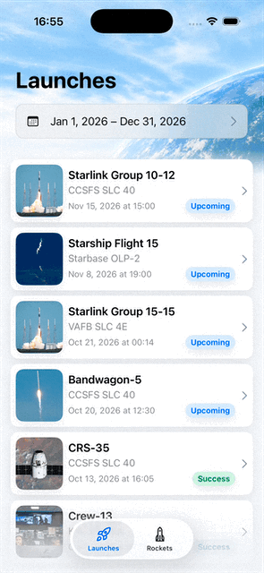
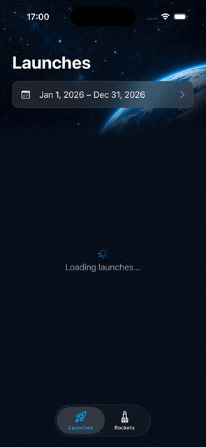

# OffToSpace

A SwiftUI app built with Swift 6.

| Light mode | Dark mode |
| --- | --- |
|  |  |

## App Features

- Browsing launches with pagination
- Filtering launches by date range
- Launch details, including status, launch site, description, and rocket
- Opening the launch webcast when available
- Browsing rockets with pagination
- Rocket details, including engine information, activity status, and success rate
- Navigation from launch details to rocket details
- Light and dark appearance


## Design Considerations

The original API was not working during development, so I created a local mock server that follows its response structure.

Each feature uses a shared interactor for pagination and temporary in-memory caching. Navigation passes IDs, and launch details use data already loaded by the list.

## Running the app

1. Start the provided backend on `http://localhost:3000`:

   ```sh
   cd mock-api
   npm install
   npm start
   ```

2. Open `OffToSpace/OffToSpace.xcodeproj` from the repository root.
3. Select the `OffToSpace` scheme and an iOS 26.5 or newer simulator, then run.

The backend requires Node.js 18 or newer. See the [mock API README](mock-api/README.md) for its endpoints and configuration.

The app points to `localhost`, which works with the simulator. To run on a physical device, change the base URL in `AppDependencies` to the Mac's LAN address.

Set `DELAY=true` to hold every response for 2 seconds so loading states and pagination are visible in the iOS. Override the wait with `DELAY_MS` (milliseconds), for example `DELAY=true npm start` or `DELAY_MS=3000 npm start`.

## Running the tests

Open `OffToSpace/OffToSpace.xcodeproj` and select the `OffToSpace` scheme. Use Product → Test (⌘U) to run the tests, or select individual tests in the Test navigator.

- **OffToSpaceTests** — XCTest unit tests.
- **OffToSpaceUITests** — XCUITest covering the two main navigation flows.

UI tests launch the app with the `uiTesting` argument. This selects in-memory repositories, so no running backend is required. The production interactors and ViewModels are still used.

To explore the same offline data manually, add `uiTesting` to the scheme's Run → Arguments Passed On Launch.

## Folder structure

Inside the `OffToSpace/` project directory:

```text
├── OffToSpace/              App target
│   ├── App/                 Entry point, AppDependencies, and AppRootView
│   ├── Core/                Networking, errors, and pagination support
│   ├── DesignSystem/        Colours, spacing, fonts, and reusable UI
│   ├── Features/
│   │   ├── Launches/        Launch list, date filter, details, and navigation root
│   │   └── Rockets/         Rocket list, details, and navigation root
│   ├── UITesting/           In-memory repositories and bundled offline fixtures
│   └── Localizable.xcstrings
├── OffToSpaceTests/          XCTest unit tests
├── OffToSpaceUITests/        XCUITest
├── AGENTS.md                Architecture and coding rules for the project
└── .swiftlint.yml
```

Each feature holds its models, DTOs, mappers, repository, interactor, screens, and navigation root. Screen contracts are separated into `View`, `ViewModel`, `ViewState`, and `ViewEvent` files.

## Architecture

Layered **MVVM**:

**View → ViewModel → Interactor → Repository → Networking (REST)**

Interactors manage pagination and the temporary cache. Repositories construct requests and map API responses into domain models. DTOs do not leak into presentation.

**View / ViewModel contract**

- The view renders `state` and sends `handle(event:)` for loading, filtering, and retry actions.
- Navigation selections are reported to the feature root through callbacks containing IDs.
- Simple editing state, such as unconfirmed dates in the filter sheet, stays in the view.
- ViewModels use Observation (`@Observable`) and are owned by their screens using `@State`.
- State is an enum unless independent properties justify a struct. `LaunchesViewState` keeps the active filter alongside its content state.

## Composition

Constructor injection, no singletons. `AppDependencies` constructs the API client and the Launches and Rockets feature dependencies. Each feature owns its repository and shared interactor, and provides ViewModel factory methods. Views and ViewModels never construct networking dependencies or repositories.

`AppEnvironment.isUITesting` switches repository implementations when the app is launched with `uiTesting`.

## Navigation

`AppRootView` composes the two tabs. `LaunchesRootView` and `RocketsRootView` own their `NavigationStack` and path, and construct destination ViewModels directly.

Child screens request navigation through ID callbacks. They do not know route types or append to the navigation path. The roots do not store screen ViewModels.

## Testing

Unit tests cover ViewModel state transitions, interactor pagination and cache behaviour, repository request construction, and response mapping.

A smaller set of UI tests covers the main user flows:

- Launches → launch details → rocket details, including scrolling to the second launch page.
- Rockets → rocket details.

The offline fixtures contain 12 launches and 3 rockets, with varied statuses, missing optional fields, and bundled imagery. Dates and statistics are synthetic demonstration data. The initial filter year is fixed for UI tests, and the tests launch in English for content assertions.

Extensive UI coverage, screenshot comparisons, and automated accessibility audits are outside the current test suite. External webcast browsing is not included in the offline UI tests.

## AI usage

Codex (GPT-6.1 Sol) and Cursor (Grok 4.6) was used to assist with implementation, refactoring, tests, and documentation. The `AGENTS.md` file contains the architecture and coding rules used for this project.
